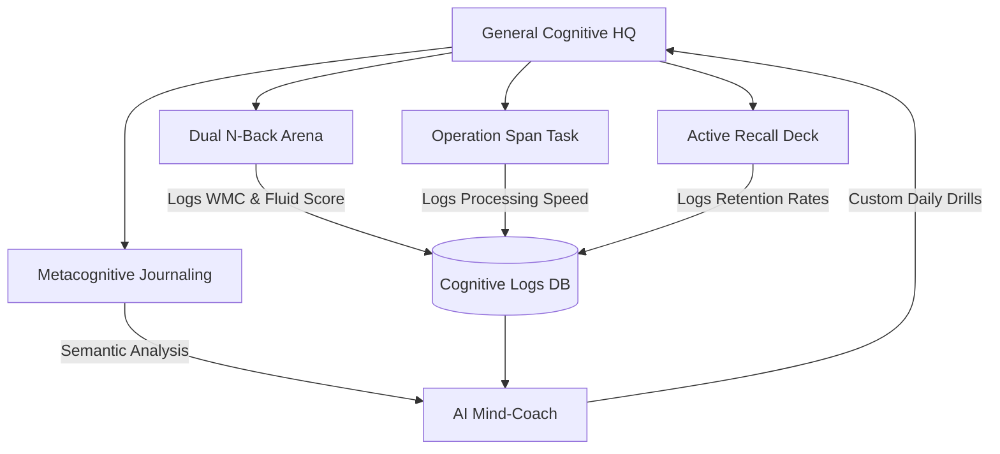

# General Cognitive Enhancement & Fluid Intelligence Design Proposal

This document reviews general cognitive training techniques aimed at increasing working memory capacity, fluid intelligence ($G_f$), focus, and executive function—often colloquially described as "adding a few IQ points" or upgrading mental processing hardware.

---

## 1. High-Impact Cognitive Exercises (General Brain Upgrades)

To build general mental capacity (not just running-specific resilience), the following exercises and paradigms have the highest support in cognitive science and neuroplasticity literature:

### 1. Dual N-Back Training (Working Memory & Fluid Intelligence)
*   **Scientific Basis:** Originally developed by Susanne Jaeggi et al. It is one of the few cognitive training exercises shown in some peer-reviewed studies to produce transfer effects to fluid intelligence ($G_f$)—the ability to reason and solve new problems independent of previously acquired knowledge.
*   **Cognitive Impact:** Increases working memory capacity, strengthens the prefrontal-parietal network, and improves focus under distraction.
*   **Execution:** A grid displays a sequence of visual locations while audio letters are played. The user must identify if the current visual square or audio letter matches the one shown $N$ steps back. As the user improves, $N$ increases (Dual 2-Back, Dual 3-Back, etc.).

### 2. Complex Working Memory Span Tasks (e.g., Operation Span)
*   **Scientific Basis:** Used in cognitive labs to measure Working Memory Capacity (WMC), which is highly correlated with general cognitive ability ($g$-factor), reading comprehension, and problem-solving.
*   **Cognitive Impact:** Trains executive attention and the ability to maintain goal-relevant information in the face of active interference.
*   **Execution:** The user must remember a sequence of letters while performing simple mathematical operations in between (e.g., See "F" -> Solve "3 + 5 = 8?" -> See "K" -> Solve "9 - 2 = 6?" -> Recall letters "F, K").

### 3. Deliberate Metacognition & Cognitive Reframing
*   **Scientific Basis:** Active metacognition (thinking about thinking) improves reasoning and decision-making by mitigating cognitive biases and reducing emotional reactivity.
*   **Cognitive Impact:** Boosts verbal reasoning, logical deduction, and emotional intelligence.
*   **Execution:** Structured journaling templates that guide users to unpack complex decisions, identify logical fallacies in their own thinking, and reframe negative cognitive loops.

### 4. Focused Attention Meditation (FAM) & Neuro-Feedback
*   **Scientific Basis:** Neuroimaging shows that FAM increases gray matter density in the anterior cingulate cortex, prefrontal cortex, and hippocampus, which are central to attention control and memory.
*   **Cognitive Impact:** Lowers mind-wandering, decreases cortisol (improving brain health), and enhances the ability to sustain attention on demanding tasks.
*   **Execution:** Concentrated breath awareness with immediate recovery response when the mind wanders, or interactive biofeedback prompts.

### 5. Active Recall & Spaced Repetition (High-Impact Learning)
*   **Scientific Basis:** The testing effect and spacing effect (Ebbinghaus, Bjork) are the most robust phenomena in cognitive psychology for converting short-term memory to permanent knowledge.
*   **Cognitive Impact:** Accelerates skill acquisition, vocabulary expansion, and conceptual mastery.
*   **Execution:** Flashcard-based recall algorithms (SuperMemo2 or similar) integrated with reading material, vocabulary, or coding syntax.

---

## 2. Proposed General Cognitive Gym Features

We can expand the Coach Conejito Mental Gym from running-focused resilience into a **General Cognitive Training HQ**.

### Proposed Implementations

#### 1. Interactive Dual N-Back Arena
*   Develop a Streamlit-based interactive Dual N-Back game.
*   Use a $3 \times 3$ grid for the visual component, and synthetic voice sounds or text-to-speech for the audio component.
*   Log peak $N$ level, accuracy, and reaction times. Present these in a "Brain Status" dashboard.

#### 2. Operation Span (O-Span) Challenge
*   Build a quick 3-minute executive function test.
*   Alternate math equations with letters to force memory updates under active processing.
*   Helpful to test focus levels before starting deep-work or learning sessions.

#### 3. Active Recall / Spaced Repetition API
*   Enable users to create "Decks" of concepts they are learning (e.g., coding, languages, history).
*   Implement a simple local SRS (Spaced Repetition System) scheduler that prompts the user with daily cards to review.

---

## 3. Next Steps & Implementation Plan

1.  **Save this general document** to [docs/general_cognitive_enhancement.md](file:///Users/attilabalazs/Projects/coach-conejito/docs/general_cognitive_enhancement.md).
2.  **Prototype Dual N-Back Game:** Create a mock-up/script in Streamlit to test performance of visual/audio components within the browser.
3.  **Integrate Cognitive Metrics with Daily Planning:** Expand the AI Coach's scope so that cognitive performance logs can be reviewed to suggest mental downtime, deep work slots, or rest days.
