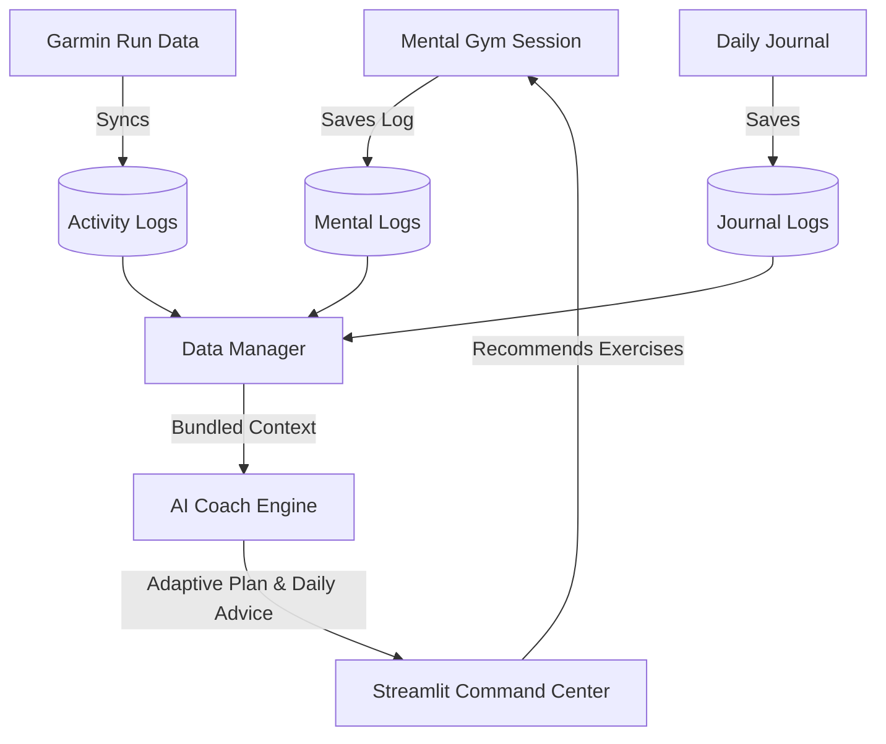

# Mental Coaching & Gym Design Proposal

This document reviews the mental training practices for Coach Conejito, enumerates the highest-impact exercises based on sports psychology and neuroscience, and outlines a technical design to integrate these features deeper into the AI coaching engine.

---

## 1. High-Impact Mental Exercises (Enumeration)

Based on exercise science, sports psychology, and cognitive neuroscience, the following five mental exercises have the highest positive impact on running performance, endurance, economy, and injury prevention:

### 1. Brain Endurance Training (BET)
*   **Scientific Basis:** Based on the psychobiological model of endurance (Marcora et al.). Mental fatigue increases Rate of Perceived Exertion (RPE), leading to premature physical exhaustion. Doing cognitive tasks (like the Stroop Test or Continuous Performance Task) under load trains the prefrontal cortex to resist fatigue.
*   **Running Impact:** Lowers perceived effort (RPE) at any given running speed, increasing time-to-exhaustion and pacing consistency, especially in the later stages of a run.
*   **Execution:** 15–30 minutes of a Stroop test or Mental Math challenge immediately before a workout (pre-fatiguing the brain) or after a hard run (training focus under exhaustion).

### 2. Instructional & Motivational Self-Talk (Mantras)
*   **Scientific Basis:** Cognitive-behavioral strategies show that replacing unstructured internal monologue with structured, repetitive self-talk overrides fatigue signals from the brain's "Central Governor."
*   **Running Impact:**
    *   *Instructional mantras* (e.g., "Relax shoulders, quick feet") improve running economy and reduce muscular tension.
    *   *Motivational mantras* (e.g., "Comfortable being uncomfortable") increase tolerance to physical pain and effort.
*   **Execution:** Selecting/creating specific mantras during planning, repeating them during high-intensity intervals or when hitting the "dip" in long runs.

### 3. Rhythmic Breathing Patterns (e.g., 3:3 and 2:2)
*   **Scientific Basis:** Mechanics of breathing directly impact core stability and joint stress. The impact of a footstrike is greatest when it coincides with the beginning of an exhalation. Breathing in an odd ratio (e.g., 3-steps-in, 2-steps-out or 3-steps-in, 3-steps-out) alternates which foot hits the ground at the start of exhalation.
*   **Running Impact:** Reduces impact stress, minimizes side stitches, increases oxygenation efficiency, and acts as an active mindfulness anchor to maintain aerobic flow.
*   **Execution:** 3:3 breathing for easy/aerobic runs; 2:2 breathing for tempo/hill work.

### 4. Course & Coping-Response Visualization (Resilience Prep)
*   **Scientific Basis:** Motor imagery activates similar neural pathways to physical movement, strengthening motor patterns. More importantly, visualizing coping strategies for stressful conditions prevents sympathetic nervous system panic.
*   **Running Impact:** Lowers pre-race/pre-workout anxiety, improves self-efficacy, and creates a pre-determined cognitive script for handling obstacles (e.g., side stitches, heavy rain, or severe leg fatigue).
*   **Execution:** 5–10 minutes of quiet, closed-eye visualization walking through the course, identifying points of peak fatigue, and visualizing the exact physical and mental coping mechanism to overcome it.

### 5. Gratitude Grounding & Sensory Exploration
*   **Scientific Basis:** Shifting focus from internal pain/performance metrics (pace, HR) to external sensory inputs or positive affective thoughts activates parasympathetic pathways, releasing dopamine and endorphins.
*   **Running Impact:** Improves mood, accelerates psychological recovery, reduces muscle tightness, and increases overall enjoyment of the sport, leading to higher long-term consistency.
*   **Execution:** Dedicating the first or last 5–10 minutes of an easy run to cycle through gratitude points (body, environment, life) and active sensory observation (sounds, temperature, colors).

---

## 2. Review of Current Implementation

Currently, [mental_gym.py](file:///Users/attilabalazs/Projects/coach-conejito/src/modules/mental_gym.py) and [app.py](file:///Users/attilabalazs/Projects/coach-conejito/src/app.py) provide:
*   **Stroop Color Test** & **Mental Math Challenge** (under Brain Endurance Training - BET).
*   **Preset lists** for Visualization (Process, Worst-case, Immersive), Mantras (Instructional, Motivational, Soul), and Breathwork (Box, Rhythmic, Gratitude).
*   **Logging mechanism** (`save_mental_log`, `load_mental_logs`) saving results to JSON files inside `data/users/{user_id}/mental/`.

### Gaps & Limitations
1.  **Orphaned Data:** The logged mental gym results (reaction times, accuracy, mantra sessions, breathwork logs) are saved in files but never fed back to the AI Coach ([gemini_coach.py](file:///Users/attilabalazs/Projects/coach-conejito/src/modules/gemini_coach.py)). The coach is blind to the user's mental fatigue.
2.  **No Direct Correlation:** There is no easy way to match a mental session with a specific Garmin activity or daily journal entry (e.g., seeing if a high pre-run Stroop score matches a high RPE on the run).
3.  **Static Workouts:** Visualization and Breathwork instructions are static text blocks. There are no timers, interactive pacing cues, or audios.

---

## 3. Proposed Integration Design

We propose a tighter integration between the **Mental Gym**, the **Daily Journal**, and the **AI Coach**.

### Key Design Enhancements

#### Phase 1: Connect Mental Logs to the AI Coach Context
Update [data_manager.py](file:///Users/attilabalazs/Projects/coach-conejito/src/modules/data_manager.py) to aggregate the last 7–14 days of mental logs. We will modify [gemini_coach.py](file:///Users/attilabalazs/Projects/coach-conejito/src/modules/gemini_coach.py) to feed these logs into the system prompt:
*   If the user has high cognitive fatigue (e.g., slow reaction times on Stroop tests), the AI Coach can suggest scaling back intense interval sessions.
*   If the user struggles with cognitive fatigue, the AI Coach can prescribe a pre-run BET session or a post-run mindfulness recovery.

#### Phase 2: Correlated Logging in Journal
When a user finishes a Garmin activity and writes their daily journal entry, automatically prompt them:
*   "Did you practice a mental exercise today?" (linking their breathing/visualization practice to their RPE).
*   Show a correlation graph in the Streamlit UI: "Stroop Reaction Time vs. Running RPE."

#### Phase 3: Interactive Breathwork Pacing & Timers
Add interactive UI elements to the Streamlit app:
*   A visual "breathing bubble" using CSS/JavaScript animations inside Streamlit components to guide the Box Breathing and Rhythmic breathing exercises.
*   A countdown timer for visualization sessions so users don't have to keep checking their phones.

---

## 4. Next Steps & Implementation Plan

1.  **Write this design document** to [docs/mental_coaching_design.md](file:///Users/attilabalazs/Projects/coach-conejito/docs/mental_coaching_design.md).
2.  **Expose Mental Gym logs in the Data Manager:** Write helper functions to retrieve recent mental training sessions formatted for prompt insertion.
3.  **Enhance the AI Coach Prompt:** Update the system instructions to explicitly interpret cognitive metrics (Stroop RT, mental fatigue) and mental practices (mantras, visual breathing) when constructing weekly/daily plans.
4.  **Create UI Improvements:** Add an interactive breathing visualizer and timer in the Streamlit tab.
